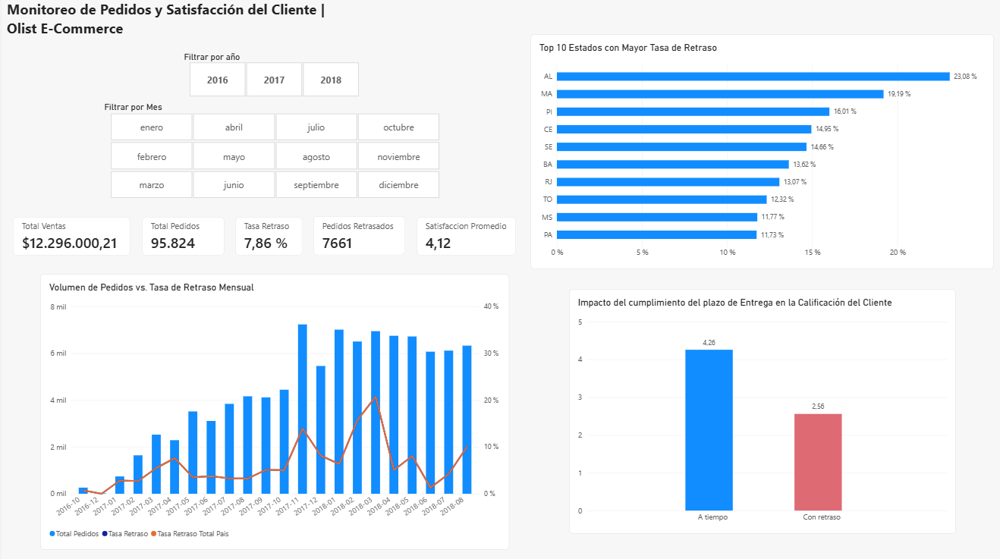
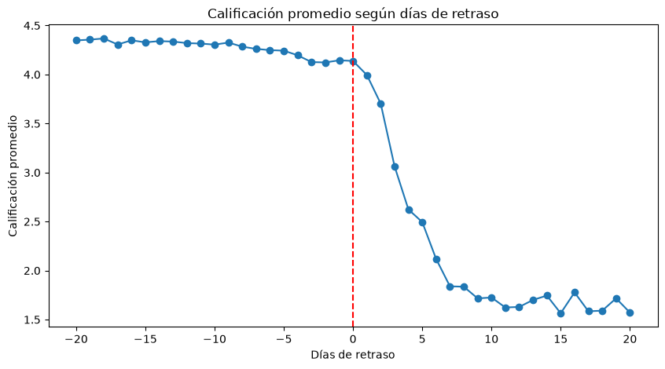
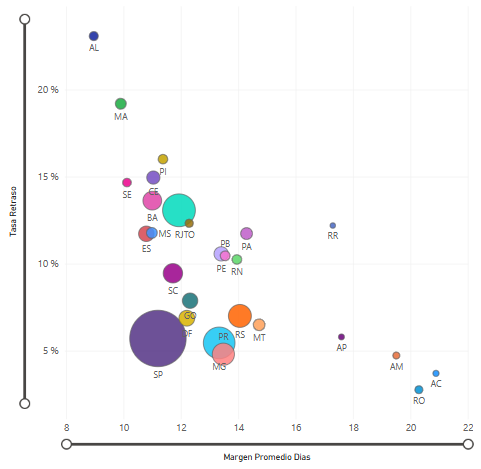
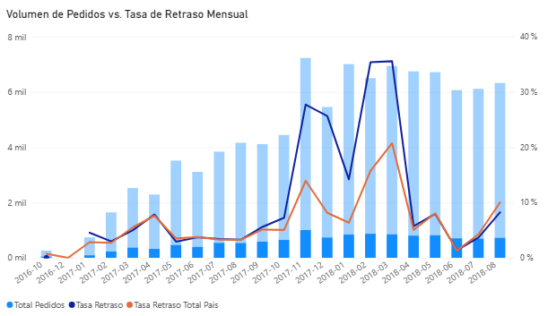
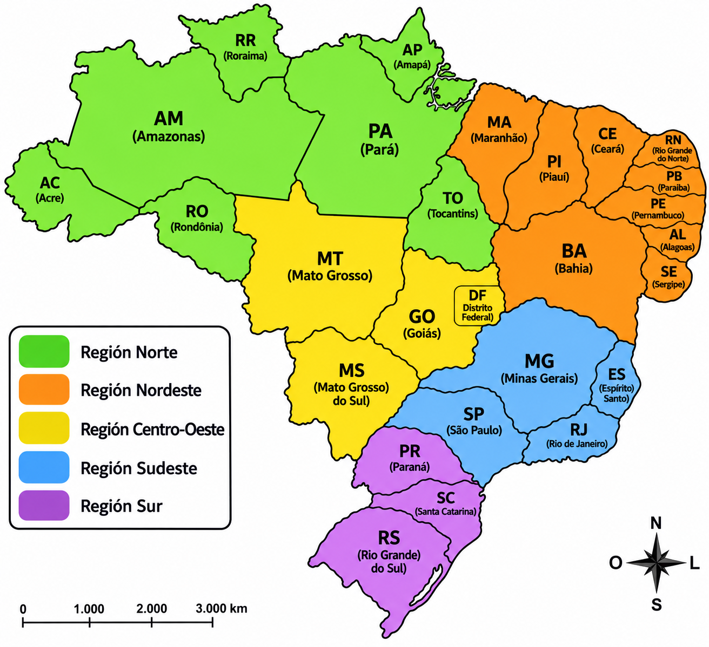
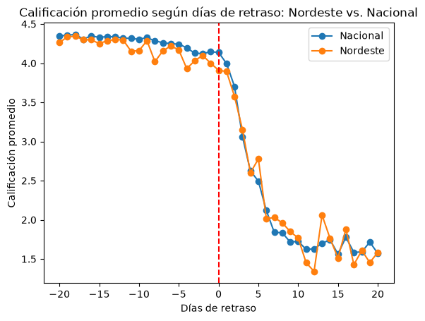

# Monitoreo de Pedidos y Satisfacción del Cliente | Olist E-Commerce

Análisis del dataset público de Olist para entender por qué algunos estados tienen tasas de retraso en la entrega mucho más altas que otros, y qué efecto tiene ese retraso sobre la calificación que deja el cliente.

**Stack:** SQLite · Python · Power BI

---

## Pregunta

¿Qué estados tienen mayor tasa de retraso en la entrega, qué la explica, y qué tanto afecta la satisfacción del cliente?

## Datos

Dataset público de Olist: tablas `orders`, `order_items`, `order_reviews`, `customers`, `products`, `sellers`, `geolocation`, `order_payments`, cargadas en `olist.db`. El análisis se limita a pedidos con `order_status = 'delivered'` y fecha de entrega registrada.

## Decisiones de preparación

- Se calculó `dias_entrega_real` (entrega real − compra) y `pedido_con_retraso` (entrega real > entrega estimada) por pedido.
- Se calculó el **margen de días** por pedido (días estimados − días desde la compra) y se agregó por estado para comparar el margen prometido contra la tasa de retraso real.
- Se exportó un modelo de tabla de hechos + dimensiones para construir el dashboard en Power BI.

```python
df_entregas['dias_entrega_real'] = (
    df_entregas['order_delivered_customer_date'] - df_entregas['order_purchase_timestamp']
).dt.total_seconds() / 86400.0

df_entregas['pedido_con_retraso'] = (
    df_entregas['order_delivered_customer_date'] > df_entregas['order_estimated_delivery_date']
)
```

## Dashboard



- **7,86%** de tasa de retraso general, sobre 95.824 pedidos en el período analizado.
- Los estados con mayor tasa de retraso son del Nordeste.
- Un pedido entregado a tiempo recibe en promedio **4,26** de calificación; uno con retraso, **2,56**.

## Hallazgos

### 1. El retraso impacta la calificación del cliente — y cambia según la cantidad de días.

Se ajustó una regresión lineal simple a nivel de pedido, a nivel nacional:

```python
import statsmodels.formula.api as smf
modelo = smf.ols('review_score ~ retraso', data=satisfaccion_pais).fit()
```

**R² = 0,133** (N=95.824, p < 0,001). El retraso por sí solo explica el 13% de la variabilidad en la calificación, con una caída promedio de **1,73 puntos** cuando el pedido llega tarde.

> El modelo no busca explicar la totalidad de la satisfacción del cliente sino aislar específicamente el efecto del retraso.

Para entender mejor ese efecto, se graficó la calificación promedio según los días de retraso, donde la parte negativa indica que el pedido llegó antes de la fecha estimada:



Llegar antes de lo estimado no mejora la calificación, pero una vez que el pedido se retrasa, la caída es rápida y se concentra en la primera semana, llegando por debajo de las 2 estrellas. Después del día 7-8, la calificación ya tocó un piso cercano al mínimo de la escala y no sigue empeorando de forma relevante.

> El R²=0.13 mide qué tan bien el retraso predice la calificación de *cada pedido individual*, donde hay mucho ruido por factores no capturados (calidad del producto, expectativas personales, etc.). El gráfico, en cambio, muestra el *promedio* de miles de pedidos por cada día de retraso. Al promediar, ese ruido se cancela y la tendencia central se ve con más claridad.

### 2. El margen de días prometido explica buena parte del retraso por estado

A nivel estado:

```python
modelo_margen = smf.ols('tasa_retraso ~ margen_promedio', data=agregado_estado).fit()
```

**R² = 0,512** (N=27 estados, p < 0,001). Por cada día adicional de margen entre la fecha estimada y la real, la tasa de retraso baja en promedio 1,09 puntos porcentuales.



El gráfico hace sentido con el resultado de R², ya que se puede observar la tendencia aun quitando algunos outliers. Por otra parte, el alza en la tasa de retraso es más pronunciado entre los 8 y 12 días de margen, lo que sugiere que ajustar los márgenes en los estados con plazos más ajustados disminuiría la tasa de retraso.

> Nota: la empresa parece asignar la expectativa de entrega por zona geográfica más que por estado individual.

### 3. RJ: top 7 en tasa de retraso. ¿mal margen?

RJ tiene una tasa de retraso de 13,07%, pero llamó la atención por ser un estado relativamente cercano a los principales `customer_state`, especialmente de Sao Paulo. Al explorar el gráfico temporal, se encontró que **el 75% de los retrasos de RJ ocurrieron en un período de 5 meses** donde la tasa de retraso también subió a nivel nacional. RJ no originó el alza. Los demás estados tienen un patrón similar durante ese mismo período.



Con los datos disponibles **no es posible aislar la causa raíz** de ese pico nacional. Podría deberse a estacionalidad, capacidad logística, u otro factor externo no capturado en el dataset.

## Conclusión

La tasa de retraso varía significativamente entre estados, y una parte importante de esa variación se explica por qué tan ajustado es el margen entre la fecha de entrega estimada y la real. El retraso, a su vez, tiene un efecto medible y significativo sobre la satisfacción del cliente.



Cruzando la tabla de margen por estado con el mapa de tasa de retraso, el **top 6 de estados con mayor tasa de retraso son todos del Nordeste** (AL, MA, PI, CE, SE, BA), con expectativas de entrega de 30-35 días. La curva de calificación según días de retraso, comparando Nordeste con el nivel nacional, muestra el mismo patrón, caída pronunciada en la primera semana de atraso, confirmando que una mejora en la tasa de retraso ahí puede convertirse en una mayor satisfacción.



**La recomendación concreta es aumentar la ventana de entrega estimada en los estados del Nordeste.** Se descarta priorizar la región Norte a pesar de ser más lejana, porque ya opera con una expectativa de entrega más generosa, tiene baja tasa de retraso y volumen de pedidos diminuto.

Sin embargo, esta recomendación podría, eventualmente, tener algún efecto sobre la decisión de compra. Idealmente, el ajuste debería probarse de forma controlada antes de aplicarse a gran escala.

## Cómo ejecutar este proyecto

**Requisitos:**
- Python 3.10+
- Jupyter Notebook o JupyterLab
- Power BI Desktop

**Pasos:**

1. Clona este repositorio:
   ```bash
   git clone https://github.com/Aniibal99/olist-ecommerce.git
   cd olist-ecommerce
   ```

2. Crea un entorno virtual e instala las dependencias:
   ```bash
   python -m venv venv
   venv\Scripts\activate        # Windows
   source venv/bin/activate     # macOS/Linux
   pip install -r requirements.txt
   ```

3. Descarga el dataset de Olist desde [Kaggle](https://www.kaggle.com/datasets/olistbr/brazilian-ecommerce) y coloca los CSV en `data/raw/`. Luego genera la base de datos local:
   ```bash
   python src/build_db.py
   ```
   Esto crea `data/processed/olist.db` a partir de los CSV descargados.

4. Abre y ejecuta el notebook:
   ```bash
   jupyter notebook `notebooks/analisis.ipynb`
   ```

5. Abre `powerbi/olist_bi.pbix` en Power BI Desktop para explorar el dashboard.

## Estructura del repositorio

```
olist-ecommerce/
├── assets/
├── data/
│   ├── processed/
│   └── raw/
├── notebooks/
│   └── analisis.ipynb
├── powerbi/
│   └── olist_bi.pbix
├── src/
│   └── build_db.py
├── .gitignore
├── README.md
└── requirements.txt
```